# Project roadmap

This README turns the [project idea](idea.md) into a sequence of deliverables. Each phase has a visible result and a completion check. Work through the phases in order because later phases depend on the hardware and traffic path established earlier.

The selected stack is Go for the controller, agents, and demo app; Next.js with TypeScript for the dashboard; HAProxy for routing; and SQLite for metrics and events. The [repository README](../README.md) has the current single-laptop runbook. The Pi, standby laptop, Wake-on-LAN, and final proxy traffic path are still pending.

```mermaid
flowchart LR
    P0[0. Agree on design] --> P1[1. Prove hardware]
    P1 --> P2[2. Set up project]
    P2 --> P3[3. Serve traffic]
    P3 --> P4[4. Collect metrics]
    P4 --> P5[5. Automate activation]
    P5 --> P6[6. Build dashboard]
    P6 --> P7[7. Add prediction]
    P7 --> P8[8. Harden system]
    P8 --> P9[9. Present results]
```

## Phase 0 — Agree on the design

- Review the component boundaries and choose one repository structure together. Reconcile the provisional scaffold and its outdated frontend descriptions with the Next.js decision.
- Confirm the Raspberry Pi model and OS, both laptop operating systems, network layout, power states, and how the operator will reach the dashboard.
- Decide where configuration, secrets, model weights, runtime data, and deployment files will live. Record the choice before moving files or writing implementation code.

**Done when:** the team has one agreed structure and a documented device/network plan. No implementation path depends on a guessed address or MAC address.

## Phase 1 — Prove the physical setup

Use the [hardware proof and results sheet](phase-1-hardware.md) to record the actual devices and wake trials.

- Connect the Pi and laptops to the same local network and give them stable addresses. The current laptop uses Wi-Fi; the final wake path must be validated before choosing Wi-Fi or Ethernet for the demo.
- Enable the standby's supported magic-packet wake mode and wake it from the Pi several times from the intended sleep state. Test shutdown separately if the hardware claims to support it.
- Record the standby MAC address, required power settings, wake success rate, and time from WoL to network reachability.
- Identify the power state to use for the demo if full shutdown cannot be woken reliably.

**Done when:** the Pi can wake the standby repeatedly and the network addresses stay stable across reboots.

## Phase 2 — Establish the software foundation

The [repository README](../README.md) now records the local service entry points, ownership, and build commands. The Next.js dependencies are locked in `web/package-lock.json`. Hardware-dependent behavior remains in later phases.

- Apply the agreed repository structure. Set up the Go module, Next.js TypeScript app, configuration example, and local development commands.
- Define the interfaces between laptop agents, the Go controller API, the Next.js dashboard, and HAProxy. Give each service one owner for its responsibilities.
- Set up build and startup paths for Pi and laptop binaries. Keep real network identifiers and credentials outside version control.

**Done when:** each component can be built or started independently on its target machine, even before its complete behavior exists.

## Phase 3 — Make the application traffic path work

The demo app now has a bounded workload endpoint, a shared [laptop Compose setup](../deploy/docker/README.md), and an [HAProxy template](../deploy/haproxy/README.md). Device addresses and the measured traffic path are still pending.

- Build one stateless Go demo app with `GET /health`, a workload endpoint, and a response that identifies which laptop served it.
- Run the same app image on both laptops through Docker Compose; make the standby app start automatically after boot.
- Configure HAProxy on the Pi as the stable client entry point. Begin with only Laptop 1 active; add Laptop 2 manually after a successful health check.
- Record the measured interval from WoL to application health, which sets the controller startup timeout and prediction horizon.

**Done when:** requests pass through the Pi, the primary serves normally, and the healthy standby can be added manually without changing the client address.

## Phase 4 — Monitor and retain evidence

The current laptop prototype collects and persists metrics for one agent, checks one demo app, and stores request-rate, average-latency, and status-change history. The remaining work in this phase includes two-laptop support and proxy-level request and latency measurements.

- Run a Go metrics agent on each laptop and collect CPU, RAM, disk, network, uptime, and temperature where supported.
- Have the Pi poll agents and probe each app's `/health` separately. Collect request rate, latency, and error counts from the proxy or app.
- Store timestamped samples and controller events in SQLite. Expose status, server, metrics, health, and event reads through the Go API.
- Show stale or missing metrics as unavailable, while keeping application health independent of agent health.

**Done when:** the Pi can show current and historical readings for both running laptops, and the event history survives a controller restart.

## Phase 5 — Automate scale up and failover

- Implement the documented states: `PRIMARY_ONLY`, `STARTING_STANDBY`, `BOTH_ACTIVE`, `FAILOVER`, and `ACTIVATION_FAILED`.
- Trigger activation after CPU stays at or above 80% for 60 seconds, or after three failed primary app health probes. Keep the timings configurable.
- Send WoL once, wait up to the configured startup timeout, and enable the standby in HAProxy only after `/health` succeeds.
- Remove an unhealthy primary promptly, prevent duplicate activation, record every transition, and provide guarded manual activate, retry, and reset actions.

**Done when:** overload and failure scenarios activate the standby without a manual step; failed startup leaves it out of traffic and produces a clear alert.

## Phase 6 — Build the operator dashboard

The current Next.js dashboard already shows live laptop and app readings, three recent trends, health, and controller events. Proxy targets, alerts, manual actions, and full activation-state views remain pending.

- Use Next.js App Router with TypeScript, Tailwind CSS, and Recharts for server cards, metrics charts, current state, and the event timeline.
- Have Next.js server-side code call the private Go API. Let the browser poll dashboard routes for current data; keep scaling decisions in Go.
- Show active HAProxy targets, application health, stale metrics, alerts, and the reason for the last transition.
- Protect operator actions in both the dashboard and Go API. Run the Next.js service separately from HAProxy and the Go controller.

**Done when:** an operator can understand and control the full activation lifecycle from the dashboard without direct access to private device endpoints.

## Phase 7 — Add the small predictive model

- Capture repeatable steady, ramp, and burst workload traces. Label whether the fixed overload rule fires within the measured boot-time horizon.
- Train a small logistic regression model in Go, keep whole workload runs separate between training and evaluation, and deploy versioned weights to the Pi.
- Show model risk, version, and availability in the dashboard. A high score on several consecutive checks may pre-wake the standby.
- Keep the reactive CPU and failure rules active. If predictions or inputs are unavailable, return to those rules; keep the health gate before routing.

**Done when:** a gradual load run can wake the standby before the reactive rule, and a comparison reports lead time, missed overloads, unnecessary wakes, request failures, and Pi inference cost.

## Phase 8 — Harden and recover

- Handle controller restarts by probing actual app health and reconciling HAProxy targets with persisted state.
- Exercise missing metrics, standby boot timeout, failed app health, primary failure while standby starts, and standby failure while both are active.
- Confirm local access controls, secret handling, service startup on boot, useful logs, and event retention.
- Document the Pi and LAN as single points of failure. Keep automatic standby shutdown out of the first completed prototype.

**Done when:** each failure has a visible outcome, unhealthy targets receive no new traffic, and a controller restart cannot silently restore a wrong routing state.

## Phase 9 — Demonstrate and document the result

- Run normal traffic, sustained load, automatic activation, warm failover, cold failover, and failed activation demonstrations.
- Compare fixed-threshold and predictive runs. Report detection time, WoL-to-health time, total activation time, request failures, latency, false wakes, and missed overloads.
- Write a setup guide with hardware settings, configuration steps, startup commands, reset steps, architecture diagrams, and known limitations.
- Capture the final dashboard timeline and measurements for the project presentation.

**Done when:** another team member can reproduce the demo from the guide and the measurements support the claims made in the presentation.

## After the completed prototype

AI-guided scale down, an external alert channel, remote access, and a high availability design for the Pi can follow after Phase 9. Scale down needs a long low-load window, request draining, a healthy primary, and a WoL-compatible standby power state.
