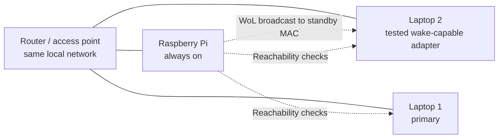

# Phase 1: physical setup and Wake-on-LAN proof

This is the working record for [Phase 1](README.md#phase-1--prove-the-physical-setup). The phase is complete only after the Raspberry Pi has woken the standby laptop repeatedly from the chosen power state and the device addresses have remained stable across reboots. Leave unmeasured values blank; do not infer them from the development laptop.

## Network layout



Keep the Pi, network equipment, and standby adapter powered during the test. Use DHCP reservations on the router or another agreed stable addressing method. The magic packet must target the MAC of the **adapter whose wake support was verified**: the Wi-Fi MAC for WoWLAN, or the Ethernet MAC for wired WoL. Record real addresses and MACs in a private local copy of the table; replace them with `configured` before committing this document. Keep credentials out of the document entirely.

## Device record

| Device | Model / OS | Wake adapter MAC (redacted in Git) | Reserved LAN address (redacted in Git) | Network link verified | Address survives reboot |
| --- | --- | --- | --- | --- | --- |
| Raspberry Pi | Raspberry Pi 4 Model B; OS pending | TBD | TBD | TBD | TBD |
| Laptop 1 (primary) | TBD | TBD | TBD | TBD | TBD |
| Laptop 2 (standby) | TBD | TBD | TBD | TBD | TBD |

- Standby firmware setting for WoL: TBD
- Standby OS/NIC setting for WoL: TBD
- Standby power source (AC/battery): TBD
- Intended standby power state (sleep/hibernate/shutdown): TBD
- Demo power state selected after testing: TBD

## Procedure

1. Connect all three devices to the same local network. Record the MAC of each adapter used for the demo and reserve each address on the router. Reboot each device and confirm its address stays the same.
2. On the standby, enable magic-packet wake in firmware and for the chosen adapter in the OS. For Wi-Fi, verify WoWLAN capability and use sleep as the first test state. Check that the adapter remains available in that low-power state. The exact menus and commands depend on the laptop model and OS.
3. From the Pi, confirm the standby is reachable while awake. Record the standby IP and MAC from the device itself or the router; do not rely solely on an ARP entry.
4. Put the standby in the intended low-power state. From the **Pi**, send one magic packet to the standby adapter's MAC on the LAN broadcast address. For example, with `wakeonlan` installed on the Pi: `wakeonlan -i <LAN-broadcast-address> <standby-adapter-MAC>`. Use the broadcast address for the actual LAN, such as `192.168.1.255` for a `192.168.1.0/24` network. The access point must forward the packet to a sleeping Wi-Fi client for WoWLAN to work.
5. Note the send time. Check reachability from the Pi once per second until the standby responds, or stop after three minutes. Record elapsed time and whether a manual power-button press was needed. Repeat at least three times, returning the standby to the same power state between runs.
6. For Wi-Fi, use a successful sleep wake as the first milestone; test shutdown only if the device documents support for it. Select the reliable state for the demo and record the limitation. Later, in Phase 3, measure wake-to-application `/health` separately; ping reachability alone does not prove the app is ready.

Pi commands useful during the session:

```sh
ip -br address
ip route
ping -c 2 <standby-LAN-address>
# After the standby enters the chosen low-power state:
date -Is
wakeonlan -i <LAN-broadcast-address> <standby-adapter-MAC>
# Repeat until reachable, recording the first successful response time:
ping -c 1 -W 1 <standby-LAN-address>
date -Is
```

`wakeonlan` is a small command-line utility; install it on the Pi if needed. These commands must be run on the Pi for the result to establish the intended Pi-to-standby path.

## Wake results

| Attempt | Power state | AC / battery | WoL sent at | First reachable at | Seconds elapsed | Woke without intervention? | Notes |
| --- | --- | --- | --- | --- | --- | --- | --- |
| 1 | TBD | TBD | TBD | TBD | TBD | TBD | |
| 2 | TBD | TBD | TBD | TBD | TBD | TBD | |
| 3 | TBD | TBD | TBD | TBD | TBD | TBD | |

- Success rate: TBD / 3
- Address stability after reboot: TBD
- Chosen demo power state: TBD
- Phase 1 status: **In progress**

## Workspace observation (2026-10-12)

At the time of this observation, the Raspberry Pi and other hardware were deferred. A Raspberry Pi 4 Model B is now available, but its OS, network connection, and wake trials are not yet recorded. The current workspace is a Lenovo IdeaPad Gaming 3 15IAH7 (type 82S9), running Linux on x86_64. It is using Wi-Fi (`wlp49s0`, Realtek RTL8852BE, driver `rtw89_8852be`); its wired Ethernet (`enp48s0`, Realtek RTL8168, driver `r8169`) is down. Both devices currently report `power/wakeup: disabled`. Linux offers `s2idle` and `deep` sleep, with `s2idle` selected.

For the present Wi-Fi-only setup, the relevant feature is **Wake on Wireless LAN (WoWLAN)**, usually tested from sleep while the adapter remains associated with the access point ([Linux Wireless documentation](https://wireless.docs.kernel.org/en/latest/en/users/documentation/wowlan.html)). The [upstream Linux RTL8852B driver](https://github.com/torvalds/linux/blob/master/drivers/net/wireless/realtek/rtw89/rtw8852b.c) advertises magic-packet WoWLAN support. The user ran `iw phy` directly on this laptop and confirmed that the loaded driver reports `wake up on magic packet`, `wake up on disconnect`, and pattern matching (up to 18 patterns). This establishes driver capability, but the laptop's firmware, access point, and sleep configuration still need an end-to-end wake trial. The workspace sandbox blocks its own `iw phy` and `ethtool` queries. Status: **magic-packet capability confirmed; actual wake untested**.

Run these read-only checks in a normal terminal on this laptop to confirm what its loaded driver exposes:

```sh
iw phy | sed -n '/WoWLAN support:/,+12p'
iw dev wlp49s0 wowlan show
cat /sys/class/net/wlp49s0/device/power/wakeup
```

The first command did list `wake up on magic packet` on this laptop. The actual proof requires a second device on the same local network to send the packet while this laptop sleeps; driver support alone is not a successful wake. Full-shutdown wake over Wi-Fi remains unverified and should not be assumed. No Pi-to-standby wake trial has been performed yet.
