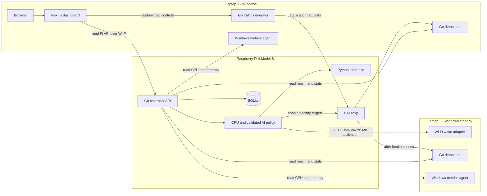

# Windows laptops, Pi controller, and CPU activation policy

This records the requested device roles and combined CPU and AI policy. Windows collection, two-server monitoring, activation, proxy control, dashboard controls, and separate startup launchers are implemented. Linux tests and Windows cross-builds verify software behavior; native Windows and physical wireless trials still require the devices. Use the [setup and test guide](windows-pi-setup.md) for the actual deployment.

## Device roles

| Device | Services | Address used by other devices |
| --- | --- | --- |
| Raspberry Pi 4 Model B, 64-bit Raspberry Pi OS | Go monitoring/control API, Python inference, SQLite, HAProxy | Pi LAN address; controller port 8080, application proxy port 8088 |
| Laptop 1, Windows primary and presentation host | Go demo app, Windows metrics agent, Next.js dashboard, Go traffic generator | Primary LAN address for app port 8000 and agent port 8081 |
| Laptop 2, Windows standby | Same Go demo app and Windows metrics agent; supported Wi-Fi wake from sleep | Standby LAN address and the tested Wi-Fi adapter MAC |

The browser opens the dashboard at `http://127.0.0.1:3000` on Laptop 1. The Next.js server uses `CONTROLLER_API_URL=http://<pi-LAN-address>:8080`. The Pi binds its API to its LAN interface and polls both laptops using their LAN addresses. Only services on the same device use `localhost` to reach each other. Reserve addresses and allow the required traffic through the Windows private-network firewall.

All three devices use the same local Wi-Fi network. A phone hotspot is acceptable only after direct HTTP access and repeated sleep/wake trials succeed. Wi-Fi client isolation or lost association during sleep can prevent wake; the project must report this as a failed hardware proof if it occurs. Do not substitute Ethernet wake capability for the required Wi-Fi trial.

## Activation policy

The implemented policy combines a CPU trigger with optional validated AI. CPU thresholds give an observable activation path while the current traffic-only model remains a research preview. CPU activation is available when hardware control is explicitly enabled; operational AI stays off by default. Operators can compare CPU-only and combined policies during evaluation.

| Signal | Proposed action |
| --- | --- |
| Primary whole-machine CPU below 60% | Normal CPU status; evaluate any validated predictive trigger separately |
| CPU from 60% to below 70% | Show warning and the configured activation threshold; no CPU-triggered wake yet |
| CPU at or above 70% continuously for 15 seconds | Request one standby activation |
| A validated, fresh AI forecast predicts requests beyond measured primary capacity | Request early activation before the CPU trigger when possible |
| AI unavailable, warming up, stale, or unvalidated | Show predictive activation unavailable; keep fresh-CPU activation available |
| Primary app fails three consecutive health probes | Failover: remove the unhealthy primary and activate standby independently of AI and CPU |

The 60% warning, 70% activation, and 15-second hold are configurable starting values, not measured capacity guarantees. Use a five-second metrics poll. Four readings at 0, 5, 10, and 15 seconds establish a 15-second hold; three readings do not. Reset the hold when CPU drops below 70%, a poll fails, timestamps repeat or go backward, a sample is older than 15 seconds, or a gap exceeds ten seconds. Never replace missing CPU readings with zero. On controller restart, start a new hold interval after reconciling the real app and proxy state.

These are whole-machine CPU readings from Windows, including the dashboard and generator on Laptop 1. They are not the Pi CPU or the demo process CPU. The current model was trained on request counts and does not predict a 70% CPU boundary. Keep its `operational_scale_ready:false` status until hardware and capacity validation justify enabling predictive activation.

A threshold initiates scaling; it does not limit CPU usage or guarantee that the system cannot crash. Wake delay, memory pressure, app faults, and the load generator also affect reliability. The generator must bound rate and concurrency, expose Stop, and show achieved throughput, errors, and latency. Measure the wake-to-healthy delay and adjust the threshold or prediction lead time accordingly.

## Wake and route sequence

1. Confirm fresh trigger evidence, configured standby address/MAC, and a previously successful Pi-to-Windows Wi-Fi wake trial.
2. Persist the reason (`cpu_sustained`, `ai_forecast`, or `primary_unhealthy`) and enter `STARTING_STANDBY` once.
3. Send the magic packet if needed. A sleeping Windows app resumes; after a boot, Windows startup must launch the app without an interactive login.
4. Probe the standby's `/health` directly for up to 180 seconds. Reachable Wi-Fi or ping alone is insufficient.
5. Enable the standby through HAProxy only after health passes. Use `BOTH_ACTIVE` if the primary is healthy, otherwise `FAILOVER`.
6. On timeout or proxy-command failure, record `ACTIVATION_FAILED`; do not report successful scaling. Suppress automatic duplicate attempts until an operator retries.
7. Keep the standby active until a guarded manual reset. Do not automatically suspend it when CPU falls below the trigger.

The dashboard shows the current CPU, warning and activation thresholds, hold progress, model availability, pending activation, serving laptops, and each transition reason and time. Closing the dashboard does not stop Pi monitoring or HAProxy.

## Telemetry and custom load

Each app exposes `/health` and `/stats`, already present in the Go demo app. The Pi reads those endpoints directly; the metrics agent exposes `/metrics` for Windows CPU, RAM, disk, uptime, and available network counters. These are read APIs polled by the Pi, so another telemetry push API is unnecessary. Per-server identity must be retained in the API and database.

Traffic Lab stays on Laptop 1 and targets the Pi's HAProxy address. Custom controls are rate with explicit RPM/RPS units, concurrency, CPU-work duration per request, and total run duration. Quick choices from 200 to 2,000 in either unit and rate switching remain available. Go validates upper bounds and the dashboard shows requested versus achieved rate; RAM size alone does not prove capacity. One primary request capacity value cannot be reused for a different CPU-work duration without measurement.

## Existing support and required implementation

| Area | Current evidence | Remaining work |
| --- | --- | --- |
| Dashboard on Laptop 1 | Remote API reads, two-server cards/history, actual activation/proxy views and operator controls implemented | Configure Pi URL/token and verify Windows presentation |
| Demo application | Windows executables built; health, identity, workload limits, stats and startup scripts supplied | Run native Windows checks and prove unattended startup |
| Metrics | Native Windows and Linux collectors implemented | Verify Windows readings against the actual host; unsupported temperature stays omitted |
| Pi monitoring | Both identities polled, separate histories persisted, per-server API reads implemented | Configure LAN addresses and verify the Pi-to-laptop path |
| CPU activation | Hold/freshness rules, persisted state, duplicate suppression and failover implemented and tested | Measure trigger timing and service benefit on hardware |
| AI | Trained artifact and shadow prediction API exist | Measure Pi inference and real service capacity; validate before hardware activation |
| Load controls | Presets and bounded custom rate, concurrency, work duration and total duration implemented | Measure achieved throughput on the actual laptops |
| Physical routing | Native magic packets and health-gated HAProxy runtime changes implemented | Configure actual LAN hosts and prove Wi-Fi wake/routing |
| Startup | Separate Pi and Windows launchers, standby scheduled task installer and Pi service template supplied | Verify Windows scheduled startup and Pi service permissions |

`config/example.yaml` is reference only. The runtime reads environment settings, with `start-pi.sh` loading `config/pi.env`. Editing YAML alone cannot activate the standby. Model predictions remain shadow recommendations by default. The controller reports `UNCONFIGURED` with hardware control disabled, then reconciles actual proxy state when configured and enabled. Explicit operational AI settings after validation are documented in the setup guide.

## Acceptance checks

- Laptop 1's dashboard reads the Pi while no controller runs on Laptop 1. Stopping Next.js leaves Pi polling running.
- Both Windows apps and agents are reachable from the Pi over Wi-Fi, with distinct identities and histories. Missing standby telemetry is visibly unavailable while it sleeps.
- CPU below 70% and short spikes do not activate standby. A full 15-second fresh hold does; stale, failed, repeated, and missing samples reset it.
- AI unavailable does not disable the CPU path. The current unvalidated model cannot send a hardware wake.
- A threshold crossing sends at most one activation request. An unready or unhealthy standby never joins HAProxy.
- Requests through the Pi identify both serving laptops after activation. Demonstrate before/after latency, throughput, errors, and CPU without claiming a guaranteed maximum CPU level.
- Repeat Pi-to-Windows Wi-Fi wake at least three times from the selected sleep state and measure wake-to-app-health time. Verify app startup separately after a reboot.
