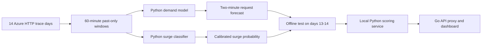

# Python serverless traffic model

The model trains directly on the **real Azure Functions 2019 invocation trace** supplied in `data/`. It forecasts the peak HTTP request count in the next two minutes and separately estimates the chance of a large traffic surge. Training, calibration, evaluation, and inference are Python. The Go controller only proxies the Python service response to the dashboard.

## Research and data provenance

- **Data:** [Microsoft Azure Functions Trace 2019](https://github.com/Azure/AzurePublicDataset/blob/master/AzureFunctionsDataset2019.md), 14 days of anonymized per-function invocation counts at one-minute resolution. The supplied archive SHA-256 is `aff8b3ca7240a41a109e4ee598e0a96e45fcb92e7b8395ac19cb3748cd260d89`. Microsoft releases the trace under CC-BY and requests citation of Shahrad et al., [*Serverless in the Wild*](https://www.microsoft.com/en-us/research/publication/serverless-in-the-wild-characterizing-and-optimizing-the-serverless-workload-at-a-large-cloud-provider/) (USENIX ATC 2020).
- **Method inspiration:** Zhang et al., [*AAPA: An Archetype-Aware Predictive Autoscaler with Uncertainty Quantification for Serverless Workloads on Kubernetes*](https://arxiv.org/abs/2507.05653) and its [author code](https://github.com/GuilinDev/aapa-simulator). AAPA uses sliding workload windows, learned patterns, and uncertainty-aware decisions on Azure traces. This project **adapts** those ideas to a smaller two-minute surge and demand model; it does not claim to reproduce AAPA's architecture or reported Kubernetes results.



The active artifact has two parts. The first-generation histogram-gradient-boosting forecaster uses recent request counts, means, maxima, trend, volatility, activity fraction, and time of day. The second-generation surge classifier uses those features plus twelve past-minute lags and shorter-window trends. The target uses only the following two minutes. Eligible function-days have at least 300 invocations and 60 active minutes. The surge label means the future peak is at least 20 requests/minute and 1.5 times the preceding five-minute mean. It is a **traffic label**, never an invented CPU or scaling-benefit label.

`serverless_model.joblib` is the **single active demo artifact**, about 193 KB. It contains the archived v1 forecaster and a richer v2 classifier, both scikit-learn histogram-gradient-boosted trees. The classifier was retrained on days 1–10 from 40% of function hashes (3,256,248 real trace windows). Days 11–12 from a separate 10% of hashes set its smooth probability calibration and threshold, targeting at least 60% validation recall with the highest precision. Days 13–14 from other function groups provide exploratory evaluation. Earlier classifiers are archived as `serverless_model_v1.joblib` and `serverless_model_v2_original.joblib`. [The experiment log](experiments.md) explains the comparisons. No model demonstrated 95% precision and recall together.

## Reproduce training

From the repository root:

```sh
python3 -m venv .venv
. .venv/bin/activate
python -m pip install -r model/requirements.txt
tar -xJf data/azurefunctions_dataset2019_azurefunctions-dataset2019.tar.xz -C data --wildcards 'invocations_per_function_md.anon.d*.csv'
OPENBLAS_NUM_THREADS=1 OMP_NUM_THREADS=2 python -m model.train_v2 --input-dir data --output-dir /tmp/serverless-model-v2-reproduction
```

The reproduction command uses `model/artifacts/serverless_model_v1.joblib` for the frozen forecast part and writes a separate artifact under `/tmp/serverless-model-v2-reproduction`. It does not overwrite the active demo file. Only load an artifact generated by trusted local code; joblib uses pickle. Changing the data or library versions can change results.

## Measured result on the supplied trace

| Function group on days 13–14 | Retrained precision / recall | Prior v2 precision / recall |
| --- | ---: | ---: |
| Hash bucket 50–60% | 52.9% / 72.3% | 52.6% / 71.7% |
| Hash bucket 60–70% | 41.3% / 59.3% | 41.2% / 57.8% |
| Hash bucket 70–80% | 48.1% / 60.6% | 49.2% / 61.4% |
| Hash bucket 80–90% | 42.8% / 62.2% | 42.7% / 62.2% |
| Hash bucket 90–100% | 42.1% / 63.6% | 40.4% / 60.9% |

The [current report](artifacts/report.json) has window counts, confusion matrices, F1, average precision, and accuracy for each function group. Four groups held or improved both measures; the 70–80% group regressed. These groups were inspected during iterative development and used to compare several models; they are **not** a fresh external benchmark, so the small gain could be selection noise. Accuracy remains above 95%, but a no-surge predictor can also score highly because surges are rare. The forecast part is unchanged from v1: on its original test sample, its error was 3.88 versus 4.31 requests/minute for a latest-minute baseline. A traffic surge still does not prove another machine is needed.

Pooled across the five reported groups (629,280 windows), observed precision changed from **45.56% to 45.81%**, recall from **63.46% to 64.23%**, and F1 from **53.04% to 53.48%** versus the prior v2. These are small exploratory improvements in traffic-surge scores, not measurements of successful server activation.

The [quality audit](experiments.md) also checked a 95%-precision threshold and XGBoost challengers. The strict threshold missed most surges and lost its high precision on unseen functions. It is **not deployed** as an alert or scaling rule.

### Independent Huawei trace

The user supplied Huawei's [2023 public serverless trace](https://github.com/sir-lab/data-release/blob/main/README_data_release_2023.md) under ignored `data/public_dataset.zip`. The frozen Azure-trained model achieved **39.32% precision and 62.93% recall** on its 26 days. This dataset includes all function triggers and does not identify HTTP functions. Blank request cells are treated as zero. The full [external report](artifacts/huawei_external_report.json) includes daily results and hashes. Reproduce it with:

```sh
OPENBLAS_NUM_THREADS=1 OMP_NUM_THREADS=2 python -m model.evaluate_huawei
```

A Huawei-only candidate improved its later-day Huawei result but lost substantial recall on Azure, so the active demo artifact remains the Azure-trained model. [The experiment log](experiments.md) has both comparisons.

Reproduce the cross-function audit without retraining:

```sh
python -m model.audit_v2 --input-dir data
```

The [current report](artifacts/report.json) records both artifact hashes, the validation threshold, and full confusion matrices. The [prior v2 report](artifacts/report_v2_original.json), [v1 report](artifacts/report_v1.json), and [strict-threshold audit](artifacts/generalization_report.json) remain for comparison.

## Raspberry Pi compatibility

The active model uses NumPy, SciPy, scikit-learn, and joblib at inference; it does **not** need XGBoost on the Pi. A 64-bit Raspberry Pi OS and Python 3.11–3.14 are needed for the pinned ARM64 wheels. The dependency versions are pinned because loading a scikit-learn joblib artifact with different library versions is unsupported. On this x86 laptop, `python -m model.benchmark --iterations 100` measured a 197,029-byte artifact, about 181 MiB peak Python process memory, 0.99 s load, and 1.70 ms median scoring. These are **laptop measurements**, not Pi measurements. The Pi model, RAM, OS, service concurrency, and latency are still unknown, so test on the actual board before calling it ready.

After copying the repository to a 64-bit Pi, run in its terminal:

```sh
python3 -m venv .venv
. .venv/bin/activate
python -m pip install -r model/requirements.txt
OPENBLAS_NUM_THREADS=1 OMP_NUM_THREADS=1 python -m model.benchmark --iterations 100
```

The large Azure `data/` archive is only needed for training and audit on a development machine. It does not need to be copied to the Pi for inference.

## Local inference

`./start-backend.sh` starts `python3 -m model.serve` when the artifact exists. It binds to `127.0.0.1:8090`; the Go controller forwards `/api/prediction` to it. The Python service reads `/api/traffic?limit=1000`, builds 60 complete one-minute request buckets, and returns a forecast and surge probability. Until 60 complete minutes are available, it returns `available:false` with a reason. The dashboard describes the result as **traffic surge risk**.


After measuring one server's sustained request capacity, `MODEL_CAPACITY_RPM=80 ./start-backend.sh` enables a **shadow decision**: `would_wake` only when the model's calibrated surge probability crosses its validation threshold and its upper request estimate reaches the configured capacity. Otherwise it reports `stay_primary`. This uses model outputs as the load signal, with capacity as the action boundary. It is a research recommendation only; it sends no wake packet. Do not use an invented capacity value as evidence of a successful scale policy.

For an offline score, write at least 60 minute counts to a JSON array and run:

```sh
python -m model.predict --counts data/minute-counts.json --minute-of-day 600 --capacity-rpm 80
```

The model is **research preview only**. It has no measured request capacity for either laptop, no standby wake time, and no observed load-balancing benefit. Its service reports `operational_scale_ready:false`, and nothing in the code sends Wake-on-LAN or changes HAProxy from this prediction. Once the second machine exists, measure single- and dual-server throughput/latency, train or calibrate the action decision with those measurements, and evaluate false wakes, missed overloads, lead time, and service quality. The model should supply the load-based activation signal; standby health and routing readiness remain action safety checks.
