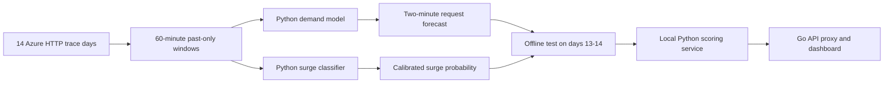

# Python serverless traffic model

The model trains directly on the **real Azure Functions 2019 invocation trace** supplied in `data/`. It forecasts the peak HTTP request count in the next two minutes and separately estimates the chance of a large traffic surge. Training, calibration, evaluation, and inference are Python. The Go controller only proxies the Python service response to the dashboard.

## Research and data provenance

- **Data:** [Microsoft Azure Functions Trace 2019](https://github.com/Azure/AzurePublicDataset/blob/master/AzureFunctionsDataset2019.md), 14 days of anonymized per-function invocation counts at one-minute resolution. The supplied archive SHA-256 is `aff8b3ca7240a41a109e4ee598e0a96e45fcb92e7b8395ac19cb3748cd260d89`. Microsoft releases the trace under CC-BY and requests citation of Shahrad et al., [*Serverless in the Wild*](https://www.microsoft.com/en-us/research/publication/serverless-in-the-wild-characterizing-and-optimizing-the-serverless-workload-at-a-large-cloud-provider/) (USENIX ATC 2020).
- **Method inspiration:** Zhang et al., [*AAPA: An Archetype-Aware Predictive Autoscaler with Uncertainty Quantification for Serverless Workloads on Kubernetes*](https://arxiv.org/abs/2507.05653) and its [author code](https://github.com/GuilinDev/aapa-simulator). AAPA uses sliding workload windows, learned patterns, and uncertainty-aware decisions on Azure traces. This project **adapts** those ideas to a smaller two-minute surge and demand model; it does not claim to reproduce AAPA's architecture or reported Kubernetes results.



The features are recent request counts, five-, fifteen-, and sixty-minute means, recent maxima, trend, volatility, activity fraction, and time of day. The target uses only the following two minutes. The forecast and classifier use shallow histogram gradient boosting; validation days calibrate probability and the upper forecast estimate. Days 1–10 train, 11–12 validate, and 13–14 are held out for evaluation. The same stable 10% of HTTP function hashes is considered on each day. Eligible function-days have at least 300 invocations and 60 active minutes. The surge label means the future peak is at least 20 requests/minute and 1.5 times the preceding five-minute mean. It is a **traffic label**, never an invented CPU or scaling-benefit label.

The committed `serverless_model.joblib` is the **single frozen demo artifact**. It contains two small estimators because forecasting demand and classifying surges are different outputs, plus probability calibration. Both estimators use scikit-learn histogram gradient boosting trained from scratch on this trace. XGBoost and CatBoost are alternative boosting libraries, not pretrained weights for these project-specific labels. We have not benchmarked them on a validation-only selection run, so we do not claim this implementation is the best possible algorithm. Its held-out improvement over the simple forecast baseline and 143 KB artifact make it the selected demo model. Keep the held-out days untouched for any future model-selection comparison.

## Reproduce training

From the repository root:

```sh
python3 -m venv .venv
. .venv/bin/activate
python -m pip install -r model/requirements.txt
tar -xJf data/azurefunctions_dataset2019_azurefunctions-dataset2019.tar.xz -C data --wildcards 'invocations_per_function_md.anon.d*.csv'
OPENBLAS_NUM_THREADS=1 OMP_NUM_THREADS=2 python -m model.train --input-dir data --sample-percent 10 --output-dir /tmp/serverless-model-reproduction
```

The reproduction command writes a separate artifact and report under `/tmp/serverless-model-reproduction`. The demo artifact at `model/artifacts/serverless_model.joblib` is protected from accidental overwrite; `--force` is required to retrain into that directory. Do not use `--force` for the demo. Only load a model artifact generated by trusted local code; joblib uses pickle. The saved model is about 143 KB. Changing the dataset, sampling, or library versions can change results.

## Measured result on the supplied trace

| Metric | Held-out days 13–14 |
| --- | ---: |
| Training / validation / test days | 1–10 / 11–12 / 13–14 |
| Training / validation / test windows | 763,416 / 156,492 / 125,856 |
| Forecast MAE / latest-minute baseline MAE | 3.88 / 4.31 requests/minute |
| 90th-percentile upper estimate coverage | 90.2% |
| Surge events / alerts | 2,603 / 3,924 |
| False alerts / missed surges | 2,167 / 846 |
| Surge precision / recall | 44.8% / 67.5% |
| Surge F1 / balanced accuracy | 53.8% / 82.9% |
| Surge accuracy / always predict no surge | 97.6% / 97.9% |
| True positives / false positives | 1,757 / 2,167 |
| False negatives / true negatives | 846 / 121,086 |
| Latest-minute alert precision / recall | 22.0% / 9.6% |

These figures are from the actual archive, with separate days for training, calibration, and test. Only the first 10 days fit the estimators; days 11–12 choose the forecast blend, calibration, and alert threshold; days 13–14 are scored once at the end. Accuracy looks high because only 2,603 of 125,856 test windows contain a surge. Always predicting no surge scores **97.9% accuracy** yet misses every surge. Precision, recall, F1, and the confusion matrix are more useful here. A traffic surge is **not** proof that an extra machine is needed. The 2,167 false alerts are still too many to justify automatically waking hardware.

## Local inference

`./start-backend.sh` starts `python3 -m model.serve` when the artifact exists. It binds to `127.0.0.1:8090`; the Go controller forwards `/api/prediction` to it. The Python service reads `/api/traffic?limit=1000`, builds 60 complete one-minute request buckets, and returns a forecast and surge probability. Until 60 complete minutes are available, it returns `available:false` with a reason. The dashboard describes the result as **traffic surge risk**.

After measuring one server's sustained request capacity, `MODEL_CAPACITY_RPM=80 ./start-backend.sh` enables a **shadow decision**: `would_wake` only when the model's calibrated surge probability crosses its validation threshold and its upper request estimate reaches the configured capacity. Otherwise it reports `stay_primary`. This uses model outputs as the load signal, with capacity as the action boundary. It is a research recommendation only; it sends no wake packet. Do not use an invented capacity value as evidence of a successful scale policy.

For an offline score, write at least 60 minute counts to a JSON array and run:

```sh
python -m model.predict --counts data/minute-counts.json --minute-of-day 600 --capacity-rpm 80
```

The model is **research preview only**. It has no measured request capacity for either laptop, no standby wake time, and no observed load-balancing benefit. Its service reports `operational_scale_ready:false`, and nothing in the code sends Wake-on-LAN or changes HAProxy from this prediction. Once the second machine exists, measure single- and dual-server throughput/latency, train or calibrate the action decision with those measurements, and evaluate false wakes, missed overloads, lead time, and service quality. The model should supply the load-based activation signal; standby health and routing readiness remain action safety checks.
